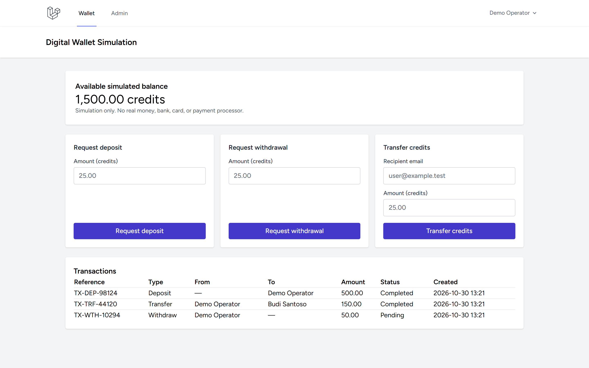
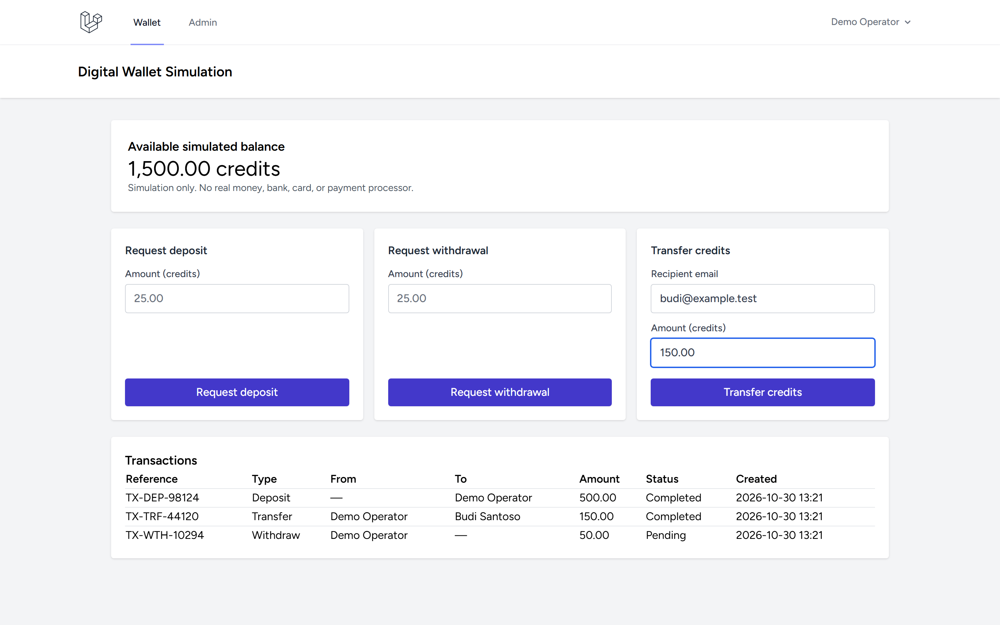
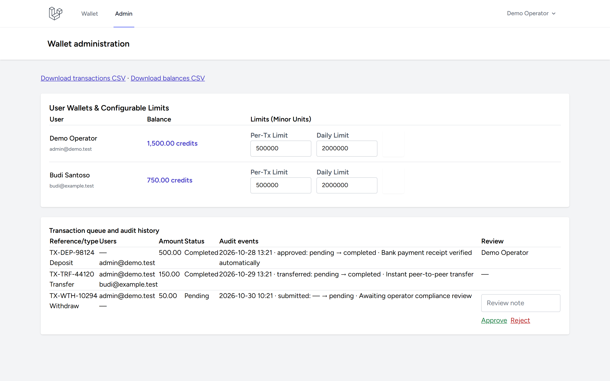

# Digital Wallet Simulation

Standalone Laravel application for educational/demo use. Simulated credits only; **not** a regulated financial product or real-money wallet. No payment rails, bank integrations, card data, or real-money claims.

## Features

- Breeze registration/login; each new user gets an empty wallet and transaction limits.
- Integer minor-unit balances and exact decimal-string input.
- Idempotent internal transfers: atomically debit, credit, create a two-sided ledger record, and append an audit event.
- Deposits/withdrawals await administrator review; approvals update balances transactionally. Withdrawal approval rechecks available funds.
- Admin-configurable per-wallet transaction/daily limits, review queue, audit history, balances and CSV exports.
- Auth, role checks, CSRF, strict validation, transaction rate limits; clients cannot set balances.

## Screenshots

| Tampilan | Preview |
|---|---|
| **Dashboard Dompet Digital**<br>Saldo kredit simulasi, formulir setor/tarik/transfer, dan tabel mutasi buku besar |  |
| **Alur Transfer Antar Pengguna**<br>Validasi email penerima, nominal kredit, dan token idempotensi transaksi |  |
| **Panel Administrasi Dompet**<br>Daftar saldo dompet pengguna dan konfigurasi limit per transaksi serta harian |  |
| **Antrean Audit & Persetujuan Mutasi**<br>Log peristiwa mutasi status transaksi dan formulir peninjauan catatan admin |  |

---

## Local setup (Windows)

```powershell
Copy-Item .env.example .env
php C:/Users/wondr/.config/herd-lite/bin/composer.phar install
npm install
php artisan key:generate
php artisan migrate --seed
npm run build
php artisan serve
```

SQLite is the default local database. Set PostgreSQL credentials in `.env` for production. Register an account. A trusted operator can grant admin access by setting `users.is_admin` to `1` directly in the database; public registration cannot assign that flag. No demo users, balances, or transactions are seeded.

## Ledger and concurrency

Amounts and balances use integer minor units (100 = one simulated credit). `wallets.balance_minor` is maintained transactionally alongside `wallet_transactions`; transfers are a single record with source and destination wallets. Deposits/withdrawals carry pending/completed/rejected status. `wallet_transaction_events` records status transitions. Idempotency keys are unique per requesting user. Transfers lock both wallets in ascending ID order. Withdrawal approvals lock and recheck the source wallet to prevent overdraft.

Use PostgreSQL/MySQL for production row-level locking and validate concurrency on that database. SQLite tests establish functional behavior, not cross-process locking. This demo does not provide real settlement/payment processing or regulatory compliance.

## Checks

```powershell
php artisan migrate:fresh --seed --no-interaction
php artisan route:list --except-vendor
php artisan view:clear
php artisan view:cache
php artisan test --compact
npm run build
php C:/Users/wondr/.config/herd-lite/bin/composer.phar validate --no-check-publish
php C:/Users/wondr/.config/herd-lite/bin/composer.phar audit
npm audit --omit=dev
```

Keep `.env`, local databases, dependencies, user data, and build artifacts out of Git.
